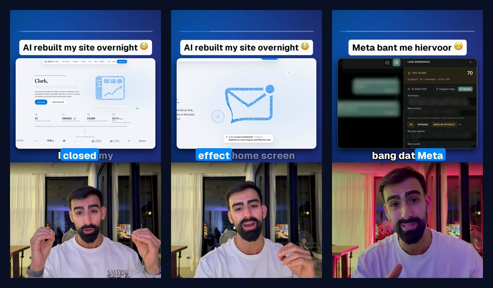
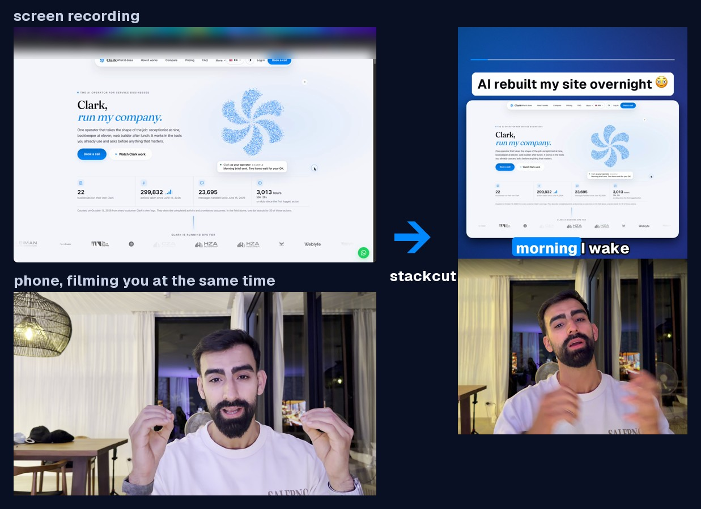
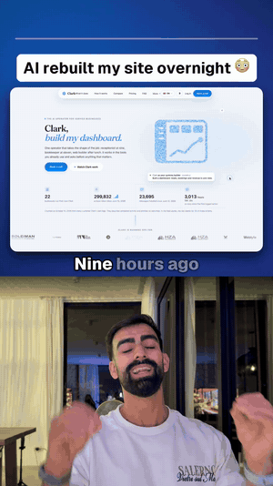
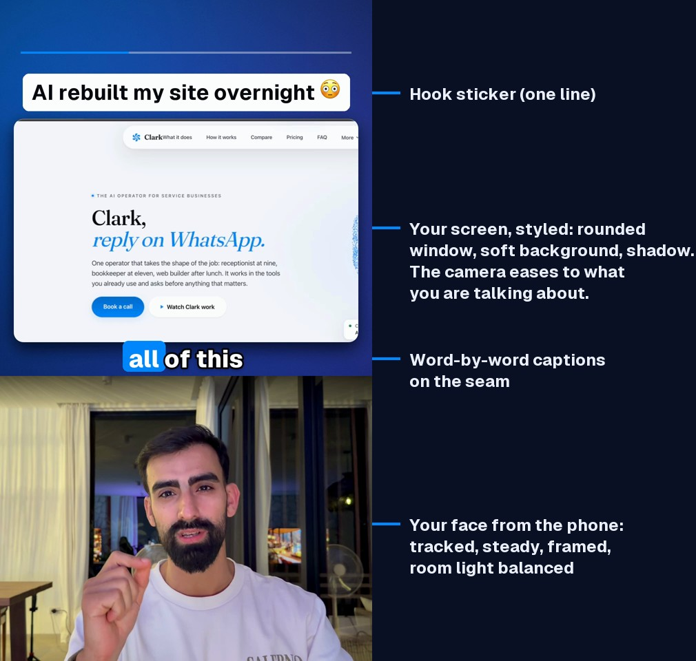

<div align="center">

# stackcut

**I suck at editing. That's why I asked my AI to edit this video.**

Screen recording + talking head → a clean vertical short.<br>
Styled screen on top, your face below, word-by-word captions in the middle.<br>
Built so your AI agent can do the editing.



</div>

Talking head plus screen share is one of the most popular formats on Reels, TikTok and Shorts. It's also a pain to edit: two recordings to sync, a screen nobody can read at phone size, pauses to cut, captions to time, a face to keep in frame.

stackcut does all of that from two files. You record your screen and, at the same time, your face on your phone. You get back a finished 9:16 video:

- **Your screen, styled.** Rounded window, soft gradient background, drop shadow (the Screen Studio / OpenScreen look), with a camera that eases in on whatever you're talking about.
- **Your face, framed.** Found and followed with a face detector, smoothed so it sits still like on a tripod, zoomed to fill the frame, room light corrected.
- **Every pause gone.** Voice-activity detection turns breaths and "uhm"s into jump cuts.
- **Captions that pop.** Word by word, a few words at a time, the keyword highlighted.
- **A hook on top.** One line, in the text-sticker style viewers already know.
- **Sound that's ready.** Cleaned voice, optional ducked music bed, mastered to -14 LUFS (the Reels/TikTok target).
- **Privacy built in.** Blur boxes on the screen recording with time windows, for client names and messages.



## Why "edited by AI"?

The edit lives in one small text file, `edit.yaml`: which sentences play, in what order, and what the screen shows meanwhile. stackcut writes a first version on its own. An AI agent like [Claude Code](https://claude.com/claude-code) can then do what an editor does: read the transcript, pick the strongest hook, drop the retakes, choose a zoom for every line, then render and check the result. The two example videos were edited exactly like that.

<div align="center"></div>

## Quick start

You need Python 3.10+ and [FFmpeg](https://ffmpeg.org) (`brew install ffmpeg` on a Mac, `apt install ffmpeg` on Linux).

```bash
git clone https://github.com/S3YED/stackcut && cd stackcut
python -m venv .venv && source .venv/bin/activate
pip install -e .
stackcut doctor
```

Then, with your two recordings:

```bash
stackcut draft screen.mp4 face.mov -o edit.yaml   # transcribe, sync, write a first edit
stackcut render edit.yaml                          # -> edit.mp4 + edit.sheet.jpg
```

`draft` keeps every sentence once (when you said a line twice, the last take wins), syncs the two recordings by their audio, and zooms automatically to where things move on screen. Good enough to post. Better after one pass by you or your AI.

## Let your AI edit it

Open the folder in Claude Code (or any coding agent) and say:

```
Edit my video with stackcut. The screen recording is screen.mp4, my face take is face.mov.
Follow CLAUDE.md in the stackcut repo.
```

[`CLAUDE.md`](CLAUDE.md) teaches the agent the whole job: transcribe, pick the hook, cut the retakes, look at the screen recording, choose zoom targets, blur private data, render, then review the contact sheet before calling it done.

## The edit file

```yaml
screen: screen.mp4
face: face.mov
offset: auto                      # face = screen + offset, measured from the audio
hook: "AI rebuilt my site overnight 😳"
music: bed.mp3                    # optional
style:
  top_crop: 0.107                 # hide the browser's tabs and address bar in full view
  accent: "#0088ff"
privacy:
  - {rect: [243, 388, 404, 858]}              # [x, y, w, h] on the screen, the whole video
  - {rect: [652, 126, 528, 92], from: 0, to: 41}   # only between these screen seconds
fix: {stream: screen}             # caption corrections, word for word
lines:                            # face-take seconds, in the order they play
  - {from: 7.30, to: 12.24, zoom: full}
  - {from: 12.22, to: 17.88, zoom: [0.65, 0.40, 2.0], join: true}
  - {from: 17.88, to: 21.50, zoom: auto}
  - {from: 51.52, to: 55.40, zoom: [0.4, 0.42, 1.5], screen_at: 44.0}
```

| Line option | What it does |
|---|---|
| `from`, `to` | The part of your face take to use (seconds). |
| `zoom` | `full`, `auto` (follows activity on screen) or `[cx, cy, z]`: the centre as fractions of the screen, plus zoom (1 = whole screen). |
| `screen_at` | Show this moment of the screen recording instead of the synced one (a cutaway). |
| `join` | The sentence continues from the line before (no full stop in the captions). |
| `tight: false` | Keep the pauses inside this line. |
| `pad_in` | Extra lead-in for a soft first word ("I", "If") that the cut would clip. |
| `cut: true` | Jump to this line's zoom instead of easing. |

Full examples: [`examples/homepage.yaml`](examples/homepage.yaml) (English) and [`examples/whatsapp-nl.yaml`](examples/whatsapp-nl.yaml) (Dutch, with a blurred client screen).

## How it works



```
screen.mp4 ─┐                      ┌─ face tracking (YuNet) ─ smooth camera ─ white balance ─┐
            ├─ sync (audio xcorr) ─┤                                                        ├─ compose ─ captions ─ encode ─> short.mp4
face.mov ───┘                      └─ transcript (Whisper) ─ silence cuts (Silero VAD) ─────┘     ↑
                                                                  voice clean-up ─ music ─ -14 LUFS
```

1. **Sync.** Both microphones heard the same words. Cross-correlating their loudness finds the offset to 10 ms.
2. **Transcribe.** faster-whisper gives word timestamps. If a take comes back without punctuation, it runs once more with a punctuated prompt in the same language.
3. **Cut.** Silero VAD finds the voiced parts of each line and every pause becomes a jump cut. A cut never clips a word.
4. **Frame the screen.** The screen recording goes in a rounded window with a soft shadow on a blurred gradient. For each line the camera eases (0.6 s, cubic) to that line's target, which you choose or `auto` measures from frame differences.
5. **Frame the face.** YuNet finds the face 10 times a second. The centre is smoothed over about 1.3 s and the size over about 3 s, so it never jitters. The face fills about a third of the panel. The white shirt under it sets the white balance.
6. **Captions.** Words land on the output timeline, a few per page; spoken words light up and the keyword gets the accent pill.
7. **Sound.** The kept audio is cut with 12 ms fades, cleaned (ElevenLabs Voice Isolator when `ELEVENLABS_API_KEY` is set, an FFmpeg chain otherwise), laid over an optional ducked music bed, and mastered to -14 LUFS.
8. **Encode.** H.264 1080x1920, 30 fps (hardware VideoToolbox on a Mac, x264 elsewhere), plus a contact sheet to review.

## Recording tips

- Record the screen and your face **at the same time**. Your phone in front of you (landscape or portrait both work), any screen recorder on the computer. Both mics on.
- Say each line once; when you mess up, just say it again. The last take wins.
- iPhone HDR footage is fine. On a Mac it is tone-mapped in hardware.
- Blur client data: `stackcut frames screen.mp4` makes a contact sheet so you (or your AI) can find what to cover.

## Credits

stackcut was made by **[Seyed Hosseini](https://www.instagram.com/seyed.jpg/)** (the idea, the footage, the taste) and **Claude** by [Anthropic](https://www.anthropic.com), working in Claude Code. Claude edited the first videos and wrote this code.

It stands on these open-source projects:

| Project | Used for | Licence |
|---|---|---|
| [FFmpeg](https://ffmpeg.org) | decoding, tone-mapping, audio, encoding (called as a program) | LGPL / GPL |
| [faster-whisper](https://github.com/SYSTRAN/faster-whisper) (Whisper by OpenAI) | transcription with word timestamps | MIT |
| [Silero VAD](https://github.com/snakers4/silero-vad) (ships with faster-whisper) | finding the pauses | MIT |
| [OpenCV](https://github.com/opencv/opencv) | image work, the face detector runtime | Apache 2.0 |
| [YuNet](https://github.com/opencv/opencv_zoo/tree/main/models/face_detection_yunet) by Shiqi Yu (OpenCV Zoo) | face detection (downloaded on first run) | MIT |
| [NumPy](https://numpy.org), [Pillow](https://python-pillow.org), [PyYAML](https://pyyaml.org) | arrays, text drawing, the edit file | BSD / MIT-CMU / MIT |
| [Geist](https://github.com/vercel/geist-font) by Vercel | caption and sticker font (bundled) | SIL OFL 1.1 |

The screen look is inspired by [OpenScreen](https://github.com/siddharthvaddem/openscreen) and Screen Studio. The example videos were recorded with [Cap](https://cap.so).

## Licence

MIT. See [LICENSE](LICENSE). The bundled Geist fonts keep their own licence ([OFL.txt](stackcut/assets/fonts/OFL.txt)). Third-party notices are in [CREDITS.md](CREDITS.md).
